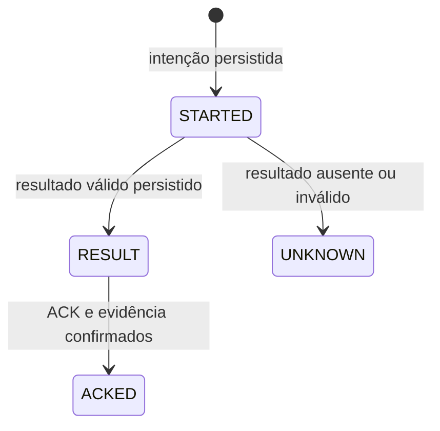

# CENTRAL-AUTO-P26 — fila autorizada e execução nativa observada

## Resultado pretendido

As candidatas anteriores exercitam a admissão, reserva e confirmação da fila
com recibos produzidos por fixtures. P24/P25 executam o n8n real, mas sem ligar
essa execução à fila. P26 une as duas partes num fluxo técnico descartável:

1. Admitir um evento canônico `mock.run.completed` pelos contratos existentes.
2. Exigir vínculo de empresa, autoridade do tenant e decisão assinada do dono
   da operação; reservar pela fachada P45.
3. Revalidar essas condições depois da reserva e registrar a intenção durável.
4. Executar no n8n real um workflow fechado de três nós nativos.
5. Conferir os identificadores, hash de conteúdo, tentativa, grafo e resultado
   efetivamente observados; persistir resultado e recibo V2 sintético.
6. Confirmar pela fachada P45, que grava ACK e evidência na mesma transação.

A operação é `run.status.project`, já contemplada pelo adaptador da candidata.
O workflow só projeta referências técnicas e estado de execução. Não aplica
regras de vendas ou de leads. O ingresso P19 `lead.ingest` e seu ACK
`dispatch=DISABLED` permanecem com o contrato original; não são convertidos
implicitamente em permissão para executar esse workflow.

## Código e confiança

- `native-run-status-noai.workflow.json`: Manual Trigger e dois nós Set,
  inativo, sem credenciais, HTTP, Code, webhook ou provedor de IA.
- `runtime/central-auto/lab-executor/native_contract.py`: pin do template,
  materialização estrita das referências, comparação do grafo exportado pelo
  n8n e validação dos resultados dos nós.
- `PgNativeExecutionLedgerLab.php` e `schema.sql`: intenção, resultado,
  estado incerto e conciliação sobre a fila existente.
- `probe.php`: adaptador exclusivamente CLI/CI para criar fixtures atuais e
  chamar as classes originais. Não é uma API ou um emissor de concessões reais.
- `check_p26_native_outbox_execution.py`: orquestra PostgreSQL, PHP e n8n
  descartáveis, executa o fluxo e exige os comportamentos negativos.

O código original Agents permanece fixado em
`3fb86c5fb011bc9df1f12a4a30a7c094370b6872`. O wrapper RC68 verifica os blobs
relevantes e executa P25 e P26 na mesma árvore temporária, sem merge commit.
As mensagens históricas `NO_REAL_N8N_EXECUTION_OR_IAM` das classes de
laboratório não são reescritas para aparentar liberação; o relatório P26
distingue a execução local observada da identidade operacional ainda ausente.

O runner de CI é o observador confiável da CLI neste ensaio. A chave Ed25519
é sintética e fica fora do n8n. O resultado é derivado de uma execução real
observada pelo runner, mas não é uma atestação independente de um executor
remoto, nem comprovação de autorização do CRM real.

## Interrupção e conciliação

O ledger identifica unicamente tenant e evento, e vincula empresa, worker,
tentativa, revisões de autoridade, bytes canônicos, hash de conteúdo e hash do
workflow materializado. Recriar um lease não apaga a intenção anterior.

O processo grava `STARTED` antes de chamar n8n. Uma interrupção nessa janela
deixa dúvida sobre o início ou término da execução; a retomada marca `UNKNOWN`
e impede nova execução automática. O sistema prefere exigir conciliação a
executar um efeito novamente sem saber o resultado anterior.

O estado `RESULT` contém o resultado validado, seu hash e o recibo assinado
antes de tentar o ACK. Um novo processo pode concluir usando esses dados sem
chamar n8n nem receber a chave privada outra vez. Se ACK e evidência já foram
gravados pela transação original, a conciliação confere esses registros antes
de atualizar o estado auxiliar para `ACKED`.

O ledger não renova concessões, não prolonga leases e não refaz assinaturas
para aceitar uma conclusão tardia. Uma tentativa antiga ou uma autorização
revogada continuam sujeitas às recusas das classes existentes. Um resultado
observado pode permanecer em `RESULT` sem conclusão autorizada.

## Revogação e tempo

As fixtures da execução usam o relógio atual depois da inicialização do n8n.
Não se usa o relógio histórico P18 para aceitar um lease ou comprovante
expirado. A admissão da intenção revalida a autoridade, o vínculo da empresa,
a decisão do dono, o conteúdo e o lease sob locks de banco.

Esses locks protegem a gravação da intenção. Eles não cancelam atomicamente
um processo n8n que já começou quando uma revogação chega depois do commit.
Por isso, o ACK revalida novamente a autorização pelas classes originais.
Se o dono revogar depois do início, o ensaio preserva o resultado observado,
nega a conclusão e não reexecuta o workflow.

## Critérios de CI

O caso principal deve terminar com uma execução n8n, um ACK e uma evidência,
inclusive depois de criar um novo processo para conciliar o resultado. Uma
segunda consulta de conciliação não gera execução nem evidência adicional.

Os negativos cobrem resultado divergente, falha ou resultado ausente,
revogação depois da reserva, tentativa antiga após nova reserva e revogação
depois do início. Também exercitam um comprovante expirado corretamente
assinado e a interrupção entre o commit de ACK/evidência e a atualização do
ledger auxiliar.

As duas execuções nativas são observações dos retornos reais da CLI pelo
runner. O Compose existente usa `EXECUTIONS_DATA_SAVE_ON_SUCCESS=none`;
por isso, o ensaio não apresenta um contador persistido no banco n8n como
prova de execução. A permanência do resultado e a unicidade de ACK/evidência
são conferidas no banco Agents. A ausência de segunda chamada é verificada
no caminho de conciliação do driver; não constitui atestação independente
da aplicação n8n.

Os testes de criptografia e o ensaio P25 continuam rodando antes da execução
P26. O check da HEAD concreta comprova o conjunto; a aprovação de uma base
antiga ou um job ignorado não conta como evidência.

## Limites

O PostgreSQL/PHP usa namespace de rede isolado e o n8n usa redes internas,
sem portas publicadas no host ou chamada de provedor. As imagens são resolvidas
antes do isolamento. Somente recursos próprios e descartáveis são limpos.

Não há worker permanente, agendamento, retry automático de execução incerta,
permissão de instalação, integração de dados reais ou alteração da main/VPS.
P19 continua sendo ingresso durável sem dispatch; vincular um evento de lead a
outra operação exige seu contrato e sua permissão próprios. O ledger novo é
de laboratório, operado no banco CI, sem alegação de RLS operacional.

**DRAFT / NO-GO operacional.** A execução nativa observada não substitui
identidade real, custódia, contrato bilateral, homologação ou autorização de
implantação.
